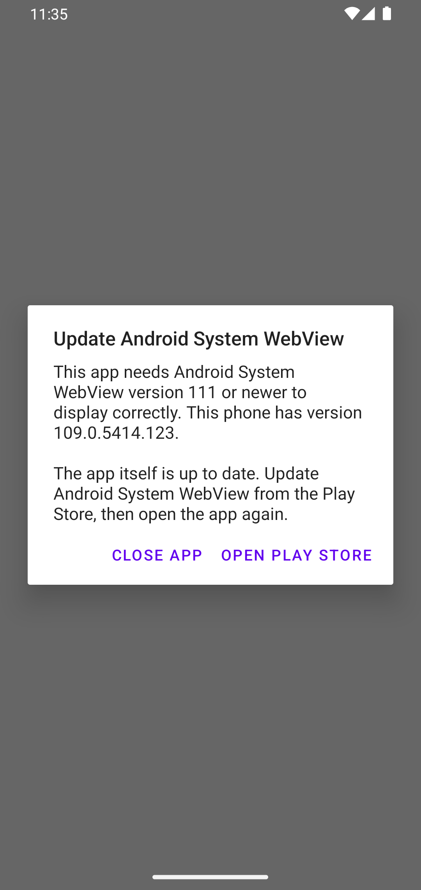
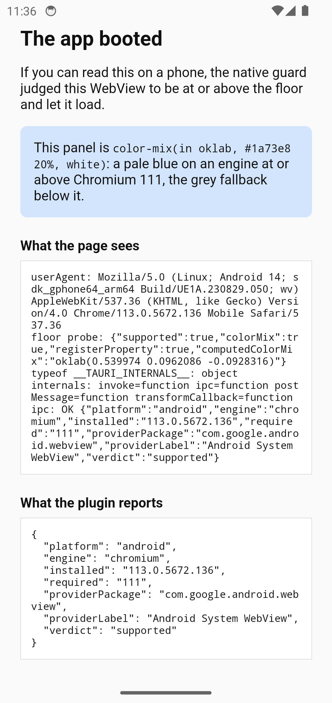

## Same APK, either side of the floor

| Android, Chromium 109                                                                                              | Android, Chromium 113                                                            |
| ------------------------------------------------------------------------------------------------------------------ | -------------------------------------------------------------------------------- |
|  |  |

Both screenshots are the same debug APK, two Chromium majors either side of the
default floor. [Device verification](/verification/) has all four emulator
arms, the iOS simulator, and what each run did and did not prove.

## In one minute

Register the plugin **first** in `src-tauri/src/lib.rs`:

```rust
tauri::Builder::default()
    .plugin(
        tauri_plugin_webview_guard::Builder::new()
            .min_chromium(111)
            .min_ios("16.4")
            .build(),
    )
    // ...
```

That is the whole integration. The guard is live the moment it is registered;
to guard nothing, do not register it. Continue with
[Getting started](/guide/getting-started).
