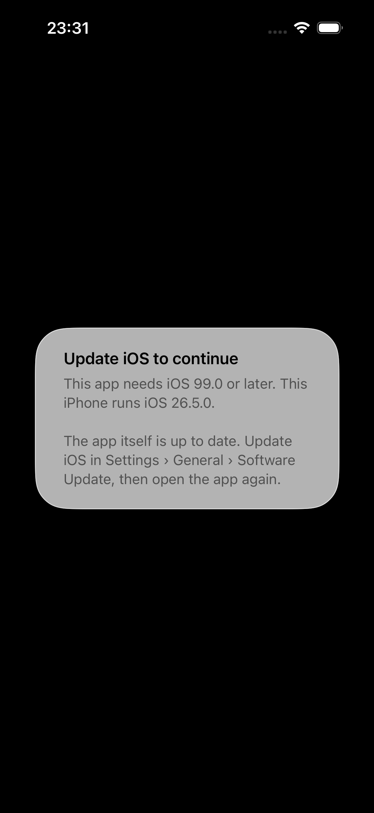

# iOS

On iOS WKWebView ships with the OS, so the engine floor _is_ an OS floor: the
default `min_ios("16.4")` is Safari 16.4, where `@property` shipped. The only
fix for a below-floor device is an iOS update.

## What is checked

`ProcessInfo.operatingSystemVersion`, as `major.minor.patch` — `ProcessInfo`
rather than `UIDevice`, because it is safe to read off the main thread, where
Tauri dispatches plugin commands. It is compared with
[`min_ios`](/guide/configuration#builder-options) inclusively, minor included.

The user agent is not used. On the iOS 26.5 simulator WKWebView's user agent
said `iPhone OS 18_7`: user-agent parsing would have misreported that device by
eight majors.

## Below the floor

- The WebView is stopped, blanked with an empty document, and hidden, in
  `load(webview:)`. Tauri's navigation hook then refuses the app's navigation
  when WebKit asks for its policy.
- A `UIAlertController` says to **update iOS**. If the root view controller
  is not in a window yet, the guard polls the run loop (every 25 ms, up to 200
  times) until it is: presenting on a detached controller would silently show
  nothing.
- The alert has **no buttons**: iOS has no public URL that opens Software
  Update (`openSettingsURLString` opens this app's own settings page — a dead
  end dressed as a way forward), and apps are not meant to quit themselves.
- `openUpdate()` returns `unsupported` — WKWebView has no store listing.

What the user sees first is a black window (the hidden WebView), then the
alert: 0.16 s from plugin construction to alert on the iOS 26.5 simulator.



## The deployment target is the real defence

In-app, the guard can only explain. The fix for iOS is not to install at all
on a version that cannot render the app — which the App Store does for you
if the deployment target says so. **Tauri 2.11.6's default is `14.0`**
(`tauri-utils`'s `ios_minimum_system_version` at tag `tauri-v2.11.6`; the
`dev` branch already says `15.0`, so anything documented from `dev` will not
match what you ship). Either way it is below 16.4. Set it:

```json
{ "bundle": { "iOS": { "minimumSystemVersion": "16.4" } } }
```

::: danger The trap: that key only takes effect on the first `tauri ios init`
The CLI writes `gen/apple/project.yml` only if it does not already exist
(`crates/tauri-cli/src/mobile/ios/project.rs` at `tauri-v2.11.6`), and no
later `tauri ios build` touches `IPHONEOS_DEPLOYMENT_TARGET`. Change the key
on an existing project and nothing happens — silently. Reproduced on this
repository's example: init at 16.4, change to 17.0, re-init → still 16.4.
:::

The reliable route is **`bundle.iOS.template`**, which `tauri ios init`
renders with `File::create` — every time:

```json
{
  "bundle": {
    "iOS": {
      "minimumSystemVersion": "16.4",
      "template": "src-tauri/ios-project.yml.hbs"
    }
  }
}
```

with `ios-project.yml.hbs` a copy of Tauri's own template for your Tauri version
(a Handlebars template, not YAML until rendered — hence the `.hbs`, which also
keeps YAML linters off it; the example carries 2.11.6's verbatim:
[`examples/tauri-app/src-tauri/ios-project.yml.hbs`](https://github.com/vaam-apps/tauri-webview-guard/blob/main/examples/tauri-app/src-tauri/ios-project.yml.hbs)).
Then re-run `tauri ios init` after every change to the key, and check:

```bash
grep -m1 IPHONEOS_DEPLOYMENT_TARGET src-tauri/gen/apple/*.xcodeproj/project.pbxproj
```

Note the path: **the template is resolved against the directory you run the
CLI in, not `src-tauri/`**. `"template": "ios-project.yml"` fails with
"failed to read custom Xcode project template" when run as `npm run tauri`
from the frontend root. Both behaviours measured:
[`docs/verification/logs/ios-trap/`](https://github.com/vaam-apps/tauri-webview-guard/tree/main/docs/verification/logs/ios-trap).

Devices that stop at iOS 15 (iPhone 6s/6s Plus, 7/7 Plus, SE 1st generation,
iPod touch 7th generation) can never reach 16.4; for them the deployment target
is the only honest answer, and the in-app alert is a dead end by nature.

## Forcing the alert on a current simulator

The example reads a floor override from the _launch_ environment (a
compile-time variable does not survive the Xcode build phase that invokes
cargo):

```bash
npm run tauri ios init
npm run tauri ios build -- --debug --target aarch64-sim
xcrun simctl install <udid> "src-tauri/gen/apple/build/arm64-sim/webview-guard example.app"
SIMCTL_CHILD_WEBVIEW_GUARD_EXAMPLE_MIN_IOS=99.0 xcrun simctl launch <udid> app.vaam.webviewguard.example
```

::: warning Not measured
No iOS 16.3 runtime was available, so the below-floor path was exercised only
with the floor forced on iOS 26.5 — see
[device verification](/verification/#ios).
:::
